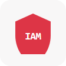
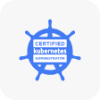
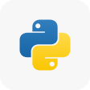
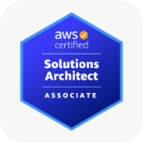
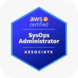
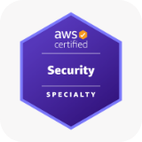
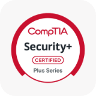
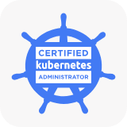
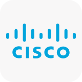

# David Nfizi

**Cloud & DevOps Engineer** · AWS, Azure, GCP · based in East Africa

I design, build and measure cloud systems, then document them down to their trade-offs.

---

## Connect with Me

- [LinkedIn](https://www.linkedin.com/in/david-nfizi-362465320)
- [Portfolio Website](https://www.davidnfizionly.com/)

---

## About Me

I started in systems administration and networking, then moved to the cloud. I hold a Bachelor of Science in Computer Science from the Catholic University of Eastern Africa in Nairobi, and I have worked as a freelance Cloud & DevOps engineer since 2024.

I treat infrastructure as a product: secure by design, defined in code, and built to scale. My projects follow the same routine: set a budget first, build with Terraform, test against real numbers, keep the evidence, then tear everything down.

Security runs through all of it: least-privilege IAM, encryption, zero trust networking and audit trails. I hold three AWS certifications (Solutions Architect Associate, SysOps Administrator, Security Specialty) and CompTIA Security+, and I am working toward CKA and CCNA.

Outside of cloud engineering, 16+ years of classical music training and sports shape how I work: discipline, attention to detail and long-term focus.

---

## Technical Skills

**Cloud & Infrastructure** - Multi-Cloud & Core Infra

<table>
  <tr>
    <td align="center" width="96"> AWS</td>
    <td align="center" width="96"> Azure</td>
    <td align="center" width="96"> GCP</td>
    <td align="center" width="96"> Terraform</td>
    <td align="center" width="96"> SQL</td>
  </tr>
</table>

**DevOps & Automation** - CI/CD & Version Control

<table>
  <tr>
    <td align="center" width="96"> GitHub</td>
    <td align="center" width="96"> Git</td>
    <td align="center" width="96"> GitHub Actions</td>
    <td align="center" width="96"> Jenkins</td>
    <td align="center" width="96"> Grafana</td>
    <td align="center" width="96"> Bash</td>
  </tr>
</table>

**Network & Security** - Security Tools & Concepts

<table>
  <tr>
    <td align="center" width="96"> Cisco</td>
    <td align="center" width="96"> Palo Alto</td>
    <td align="center" width="96"> Fortinet</td>
    <td align="center" width="96"> AWS IAM</td>
    <td align="center" width="96"> SOC Analyst</td>
    <td align="center" width="96"> Splunk</td>
    <td align="center" width="96"> Incident Response</td>
  </tr>
</table>

**Containers, Linux & AI** - Runtime & Intelligence

<table>
  <tr>
    <td align="center" width="96"> Docker</td>
    <td align="center" width="96"> Kubernetes</td>
    <td align="center" width="96"> Linux</td>
    <td align="center" width="96"> Python</td>
    <td align="center" width="96"> OpenAI</td>
  </tr>
</table>

---

## Certifications

<table>
  <tr>
    <td align="center" width="140"> AWS Solutions Architect Associate</td>
    <td align="center" width="140"> AWS SysOps Administrator</td>
    <td align="center" width="140"> AWS Security Specialty</td>
    <td align="center" width="140"> CompTIA Security+</td>
    <td align="center" width="140"> CKA in progress</td>
    <td align="center" width="140"> CCNA in progress</td>
  </tr>
</table>
